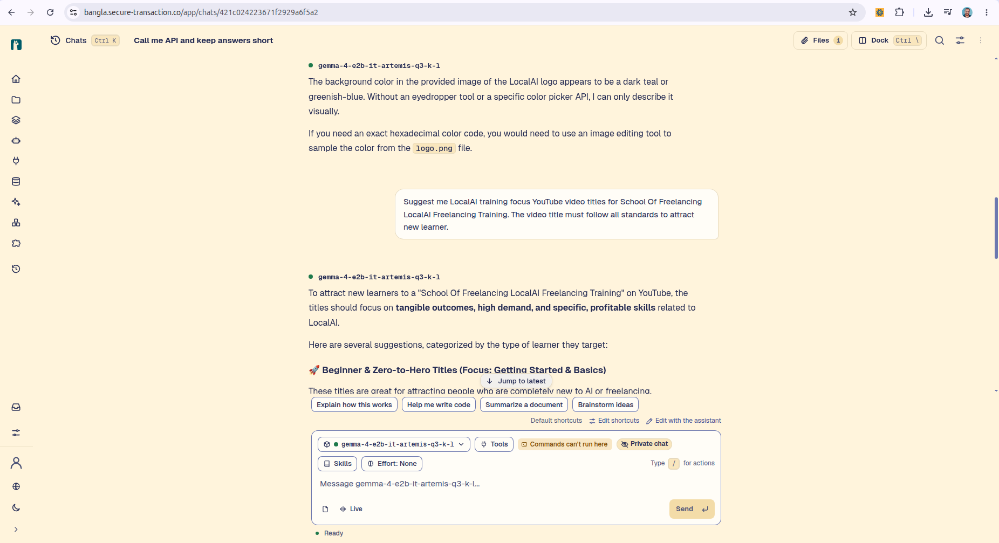

# LocalAI Training

## Learn LocalAI. Build AI Infrastructure. Freelance Globally.

<p align="center">
  <a href="LICENSE"></a>
  <a href="https://schooloffreelancing.com/freelancing-training/local-ai-training"></a>
  <a href="https://schooloffreelancing.com/freelancing-training/local-ai-training"></a>
  <a href="https://schooloffreelancing.com/freelancing-training/local-ai-training"></a>
  <a href="https://t.me/SchoolOfFreelancingTraining"></a>
</p>

A live, mentor-led 4-week training program by [School Of Freelancing](https://schooloffreelancing.com/) focused on deploying self-hosted AI servers on Linux and offering AI infrastructure services to clients worldwide.

## Repository Structure

```text
LocalAI-Training/
├── assets/       # Banners & visual docs
├── configs/      # Docker, YAML & SSL proxy configs
├── labs/         # Weekly hands-on guides (Weeks 1–4)
├── templates/    # Gigs, proposals & outreach copy
├── LICENSE       # MIT License
└── README.md     # Program guide & 20-session syllabus
```

## Program Snapshot

- **Fee:** $111 USD (one-time payment)
- **Schedule:** 4 weeks · 20 live sessions (5 per week)
- **Format:** 100% live sessions with Karim (Masum) — no prerecorded videos
- **Level:** Beginner to Intermediate
- **Course Page:** [LocalAI Training](https://schooloffreelancing.com/freelancing-training/local-ai-training)

## Requirements Before Starting

- Ubuntu Linux VPS (no dedicated GPU needed)
- Registered domain or subdomain
- Verified accounts on Upwork, Freelancer, or Guru

## 20-Session Curriculum & Lab Links

### [Week 1 — Foundation (Sessions 1–5)](labs/week-01-linux-localai/README.md)
*Milestone: Working LocalAI server on Linux answering OpenAI-compatible API requests.*
1. **Session 1:** Core architecture and OpenAI-compatible REST interface.
2. **Session 2:** Server sizing and why dedicated GPUs are optional.
3. **Session 3:** Installing LocalAI via Docker or binary on Ubuntu.
4. **Session 4:** CLI flags, config files, and the model gallery.
5. **Session 5 (Lab):** Installing a starter model and running your first API prompt.

### [Week 2 — Model Deployment (Sessions 6–10)](labs/week-02-model-deployment/README.md)
*Milestone: Quantized text models and image generation endpoints running on your private API.*
6. **Session 6:** Loading `llama.cpp` backends and quantized GGUF weights.
7. **Session 7:** Prompt templates and context window tuning.
8. **Session 8:** Quantization tradeoffs on `/v1/chat/completions`.
9. **Session 9 (Lab):** Deploying a GGUF LLM and querying via `curl` and Postman.
10. **Session 10:** Configuring Stable Diffusion-compatible image endpoints.

### [Week 3 — Multimodal & Security (Sessions 11–15)](labs/week-03-multimodal-security/README.md)
*Milestone: Vision and voice services secured behind API keys, reverse proxy, and SSL.*
11. **Session 11:** Image captioning and visual analysis endpoints.
12. **Session 12:** Video-generation workflow basics.
13. **Session 13 (Lab):** Generating images and captions via REST API calls.
14. **Session 14:** Speech-to-text (STT) and text-to-speech (TTS) backends.
15. **Session 15:** Locking down endpoints with API keys, reverse proxy, and SSL.

### [Week 4 — Client Launch (Sessions 16–20)](labs/week-04-freelance-projects/README.md)
*Milestone: End-to-end portfolio deployment, marketplace profiles, and live proposal review.*
16. **Session 16:** Connecting LocalAI to a client-facing web or backend app.
17. **Session 17 (Lab):** Wiring STT/TTS endpoints behind an HTTPS reverse proxy.
18. **Session 18:** Full fresh-VPS deployment with multimodal models, domain, and SSL.
19. **Session 19:** Optimizing Upwork, Freelancer, and Guru profiles and pricing.
20. **Session 20 (Assessment):** Live review of 1 client proposal and 1 LinkedIn outreach message.

## Enrollment & Important Links

- **Full Syllabus & Registration:** [LocalAI Training](https://schooloffreelancing.com/freelancing-training/local-ai-training)
- **Website:** https://schooloffreelancing.com/
- **Mentor Chat:** [Telegram Training Channel](https://t.me/SchoolOfFreelancingTraining)

<p align="center">
  
</p>

## Note

This training prepares you to offer LocalAI services as a freelancer. See [Training Rules](https://schooloffreelancing.com/legal/training-rules).

## License

Distributed under the [MIT License](LICENSE).

